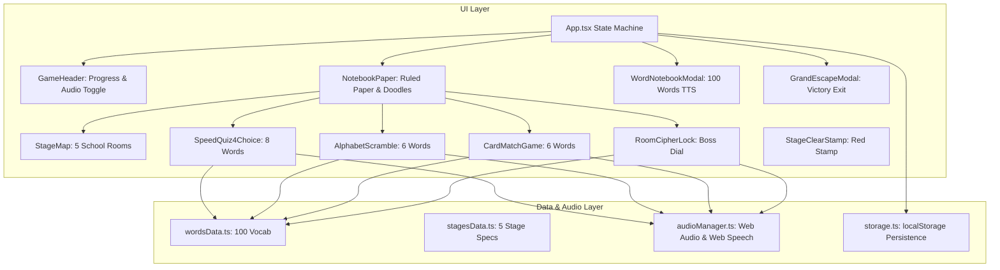

# 초등학교 6학년 필수 영단어 100개 방탈출 웹앱 Implementation Plan

> **For agentic workers:** REQUIRED SUB-SKILL: Use superpowers:subagent-driven-development to implement this plan task-by-task. Steps use checkbox (`- [ ]`) syntax for tracking.

**Goal:** 초등학교 6학년 필수 영단어 100개를 학습하고 탈출하는 Doodle / Notebook / Blue Ink 테마의 인터랙티브 방탈출 웹앱 구축

**Architecture:** React 18 + Vite + TypeScript + Tailwind CSS 기반의 클라이언트 SPA 구조. Web Audio API를 활용한 무의존성 절차적 효과음(연필 사각거림, 도장 쾅 등)과 Web Speech API(영단어 원어민 TTS)를 탑재하며, 5개 테마 스테이지별 3단계 아케이드 스피드 퀴즈(4지선다, 스크램블, 카드 매칭) 및 최종 금고 다이얼 잠금 해제 시스템으로 구성됩니다.

**Architecture Diagram:**

**Tech Stack:**
- React 18 / Vite / TypeScript
- Tailwind CSS + Custom CSS (Notebook Lined Paper, Blue Ink, Red Marker)
- Google Fonts (`Gaegu`, `Caveat`, `Patrick Hand`)
- Web Audio API (Synthesized Pencil/Stamp Sound Effects)
- Web Speech API (Native `en-US` SpeechSynthesis)
- Lucide React (Icons)

## Global Constraints
- Target age: 6th grade elementary school students (Korean curriculum essential vocabulary 100 words).
- Visual palette strictly enforced: `#0000CD` (Primary Blue Ink), `#FF0000` (Correction Red Ink), `#FFFFFF` (Paper / Tippex), lined/grid notebook paper background.
- Hand-drawn marginalia: stick figures, stars, arrows, coffee ring stain.
- No external server dependencies or cloud sync: self-contained and runs offline in browser.
- High accessibility & legibility: high contrast text against paper background.

---

### Task 1: Project Scaffolding & Visual Style Setup

**Files:**
- Create: `package.json`, `vite.config.ts`, `tsconfig.json`, `tsconfig.node.json`, `tailwind.config.js`, `postcss.config.js`, `index.html`
- Create: `src/main.tsx`, `src/index.css`, `src/vite-env.d.ts`

**Interfaces:**
- Produces: Working React + Vite + Tailwind build environment with custom Google Fonts and notebook background utility classes.

- [ ] **Step 1: Create package.json and configuration files**
- [ ] **Step 2: Install dependencies (react, react-dom, lucide-react, tailwindcss, vite, typescript, etc.)**
- [ ] **Step 3: Setup Google Fonts in index.html (Gaegu, Caveat, Patrick Hand)**
- [ ] **Step 4: Configure Tailwind & custom lined notebook paper styles in src/index.css**
- [ ] **Step 5: Verify build with `npm run build`**
- [ ] **Step 6: Commit changes: `feat: scaffold vite react tailwind project with notebook doodle styling`**

---

### Task 2: Data Models & 100 Vocabulary Dataset

**Files:**
- Create: `src/data/wordsData.ts`
- Create: `src/data/stagesData.ts`
- Create: `src/types/game.ts`

**Interfaces:**
- Consumes: Nothing
- Produces: `WordItem[]` (all 100 words with ID, English word, Korean meaning, stage ID, phonetic, example sentence, hints), `StageItem[]` (5 stages with scenario, themes, and boss cipher code), TypeScript definitions.

- [ ] **Step 1: Define TypeScript models in `src/types/game.ts`**
- [ ] **Step 2: Create `src/data/wordsData.ts` with all 100 verified 6th grade words**
- [ ] **Step 3: Create `src/data/stagesData.ts` with 5 rooms and cipher riddles**
- [ ] **Step 4: Write unit validation script/test verifying exactly 100 words, 20 per stage, unique IDs**
- [ ] **Step 5: Commit changes: `feat: add 100 essential vocabulary words and 5 stage datasets`**

---

### Task 3: Audio Manager & Local Storage Persistence

**Files:**
- Create: `src/utils/audioManager.ts`
- Create: `src/utils/storage.ts`

**Interfaces:**
- Consumes: `src/types/game.ts`
- Produces: `audioManager` (`playPencilScratch`, `playStampDing`, `playScratchOut`, `playPageFlip`, `playFanfare`, `speakWord`, `toggleSound`), `storage` (`saveGameProgress`, `loadGameProgress`, `resetGameProgress`).

- [ ] **Step 1: Implement procedural Web Audio API sounds in `src/utils/audioManager.ts`**
- [ ] **Step 2: Implement Web Speech API TTS wrapper with speech synthesis fallback in `src/utils/audioManager.ts`**
- [ ] **Step 3: Implement local storage progress sync in `src/utils/storage.ts`**
- [ ] **Step 4: Verify audio manager without errors in node/browser environment**
- [ ] **Step 5: Commit changes: `feat: add web audio effects, web speech tts, and local storage manager`**

---

### Task 4: Layout & Marginalia Doodle Components

**Files:**
- Create: `src/components/layout/NotebookPaper.tsx`
- Create: `src/components/layout/DoodleElements.tsx`
- Create: `src/components/header/GameHeader.tsx`

**Interfaces:**
- Consumes: `audioManager`, `gameProgress`
- Produces: Reusable notebook container with lined paper, red margin line, binder rings, coffee stain SVG, stick figures, and header progress/sound controls.

- [ ] **Step 1: Create `src/components/layout/DoodleElements.tsx` with hand-drawn SVG stick figures, stars, arrows, coffee ring stain, taped notes**
- [ ] **Step 2: Create `src/components/layout/NotebookPaper.tsx` rendering notebook grid/lined paper with binder spirals and margin notes**
- [ ] **Step 3: Create `src/components/header/GameHeader.tsx` showing current stage, 100-word progress bar, sound toggle, and wordbook button**
- [ ] **Step 4: Verify layout rendering in React**
- [ ] **Step 5: Commit changes: `feat: implement notebook paper container, doodle elements, and game header`**

---

### Task 5: 3-Phase Speed Quiz Engines

**Files:**
- Create: `src/components/stages/SpeedQuiz4Choice.tsx`
- Create: `src/components/stages/AlphabetScramble.tsx`
- Create: `src/components/stages/CardMatchGame.tsx`

**Interfaces:**
- Consumes: `WordItem[]`, `audioManager`
- Produces: Interactive speed mini-game components for 8 4-choice questions, 6 scrambled words, and 6 matching pairs (12 cards) with animations, combo counters, and red correction ink feedback.

- [ ] **Step 1: Build `SpeedQuiz4Choice.tsx` with speed timer, instant red-circle ding on correct, scribble strike-through on incorrect, combo streak**
- [ ] **Step 2: Build `AlphabetScramble.tsx` with interactive letter tiles, scratch sound, undo, hint meaning, and pronunciation button**
- [ ] **Step 3: Build `CardMatchGame.tsx` with flip animations, match detection, and pencil checkmarks**
- [ ] **Step 4: Test each quiz phase with sample word inputs**
- [ ] **Step 5: Commit changes: `feat: implement 4-choice blitz, alphabet scramble, and card match quiz engines`**

---

### Task 6: Room Escape Cipher, Stage Clear Stamp & School Map

**Files:**
- Create: `src/components/stages/RoomCipherLock.tsx`
- Create: `src/components/stages/StageClearStamp.tsx`
- Create: `src/components/stages/StageMap.tsx`

**Interfaces:**
- Consumes: `StageItem`, `audioManager`
- Produces: Boss cipher dial with collected clues, animated red rubber stamp clear sequence, and interactive hand-drawn school map.

- [ ] **Step 1: Build `RoomCipherLock.tsx` featuring mechanical/hand-drawn cipher dials, clue reminders, and unlock mechanism**
- [ ] **Step 2: Build `StageClearStamp.tsx` with bouncing red ink 'PASSED / EXCELLENT' stamp and reward announcement**
- [ ] **Step 3: Build `StageMap.tsx` with hand-drawn floor plan of the 5 rooms (Classroom, Library, Science Lab, Art Room, Secret Vault)**
- [ ] **Step 4: Test cipher unlocking and clear stamp transitions**
- [ ] **Step 5: Commit changes: `feat: implement boss cipher lock, stage clear stamp, and school floor map`**

---

### Task 7: Vocabulary Notebook Modal & Grand Escape Ending

**Files:**
- Create: `src/components/modals/WordNotebookModal.tsx`
- Create: `src/components/ending/GrandEscapeModal.tsx`
- Modify: `src/App.tsx`

**Interfaces:**
- Consumes: `wordsData`, `stagesData`, all stage components
- Produces: 100-word searchable study notebook modal with audio TTS pronunciation, grand finale escape ceremony with master certificate, and full App state management.

- [ ] **Step 1: Build `WordNotebookModal.tsx` with filter by stage (All, Stage 1~5), search bar, mastered indicator, and speech button**
- [ ] **Step 2: Build `GrandEscapeModal.tsx` with confetti/doodle celebration, completion badge, and replay/review options**
- [ ] **Step 3: Wire full game flow in `src/App.tsx` (Stage Map -> Phase 1 -> Phase 2 -> Phase 3 -> Boss Cipher -> Clear Stamp -> Next Stage -> Final Grand Escape)**
- [ ] **Step 4: Verify complete application builds with `npm run build`**
- [ ] **Step 5: Commit changes: `feat: integrate vocabulary notebook, grand escape ending, and full app state machine`**

---

### Task 8: End-to-End Verification & Polish

**Files:**
- Test & Polish: All UI components, responsive layout on desktop & mobile, audio playback, TTS voice.

- [ ] **Step 1: Start local dev server and test in browser using Playwright**
- [ ] **Step 2: Verify all 100 words are present and correct**
- [ ] **Step 3: Test speech synthesis and audio toggle**
- [ ] **Step 4: Test gameplay flow across all 5 stages**
- [ ] **Step 5: Capture screenshot and verify visual fidelity (blue ink #0000CD, red #FF0000, lined paper, stick figures, coffee stain)**
- [ ] **Step 6: Commit all final polish and documentation**
